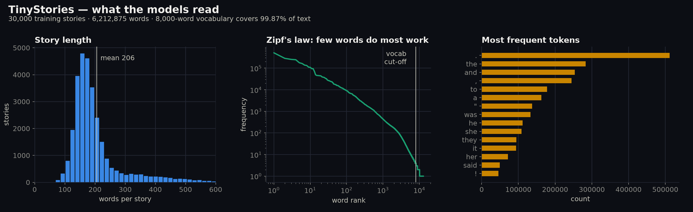
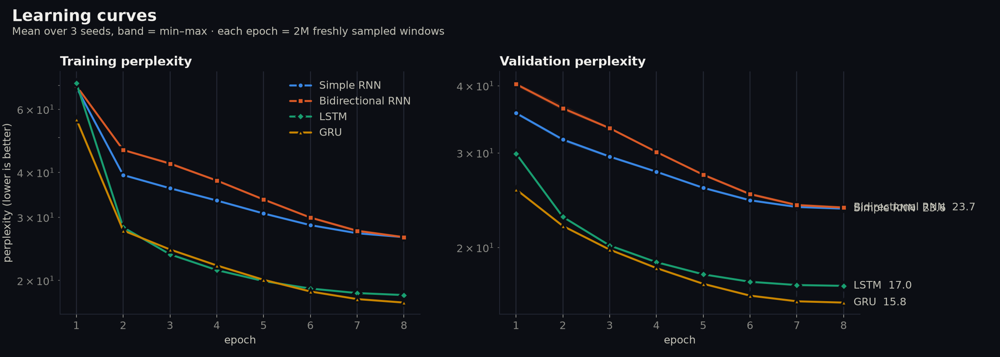
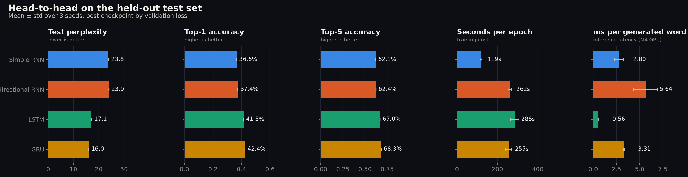
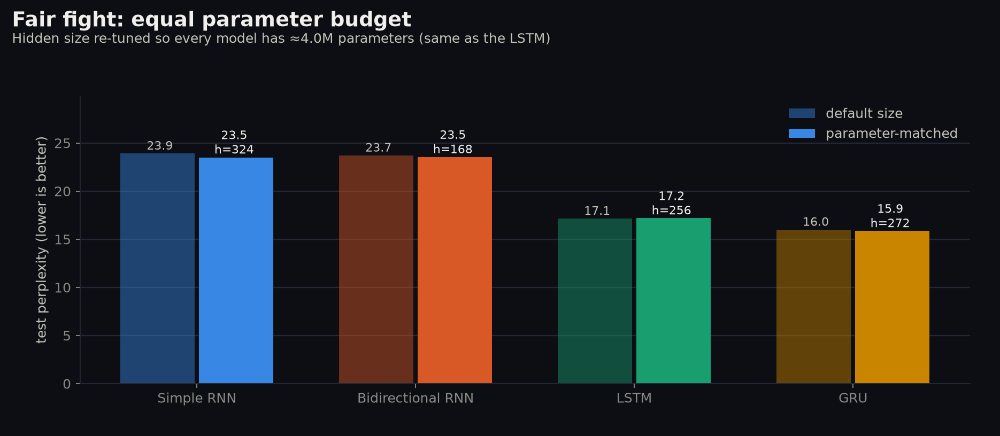
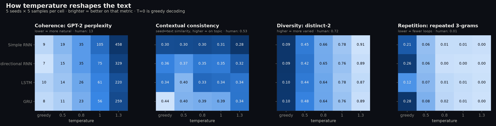
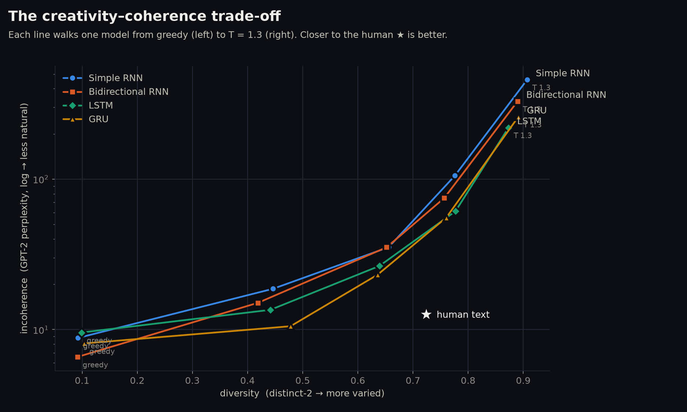

# ECHO — Autoregressive Text Generation with Simple RNN, Bidirectional RNN, LSTM and GRU

**Foundations of Generative AI (ICT4403) · Assignment 2** · Ryan Gupta · Reg. No. 230953288

**Live demo:** https://ryangupta16.github.io/ECHO/ — all trained models run in the browser (ONNX Runtime Web); type a seed, pick a model and a temperature.

---

## 1. Problem statement and objective

**Problem.** Build a word-level *autoregressive* text generator: a model that reads the previous words, predicts a
probability distribution over the next word, samples it, appends it to the context and repeats.

**Objectives**
1. Describe and preprocess a text dataset and construct the input–target sequences for next-word prediction *(Task i)*.
2. Implement and train **Simple RNN, Bidirectional RNN, LSTM and GRU** under identical experimental conditions *(Task i)*.
3. Compare them quantitatively (loss, perplexity, accuracy, training time) and qualitatively (coherence, diversity,
   contextual consistency, repetition of generated text) *(Task ii)*.
4. Generate from the same seed sequences at five sampling temperatures, analyse the effect of temperature, and justify
   the most effective model *(Task iii)*.

## 2. Dataset

**TinyStories** (Eldan & Li, 2023): short stories written by GPT-3.5/GPT-4 using only words a 3–4-year-old
understands. **Source:** https://huggingface.co/datasets/roneneldan/TinyStories
(paper: https://arxiv.org/abs/2305.07759).

**Why this dataset:** it has a small, consistent vocabulary and simple grammar, and every story has a clear plot. That lets small
recurrent models learn real long-range structure (characters, causes, endings) instead of being swamped by rare
words, and makes the differences in coherence between architectures visible.

| Characteristic | Value |
|---|---|
| Stories used | 30,000 train (official *train* split) · 2,500 val · 2,500 test (disjoint slices of the official *validation* split) |
| Tokens | 6.21 M train · 0.47 M val · 0.46 M test |
| Words per story | mean 206, min 53, max 1,024 |
| Unique words (train) | 12,951 |
| Vocabulary kept | 8,000 most frequent words, covering **99.87 %** of train tokens (`<unk>` rate 0.13 % train, 0.27 % test) |
| Most frequent tokens | `. the and , to a " was he she they it her said !` |



**Preprocessing** (`src/echo/data.py`)
1. Unicode normalisation; curly quotes / dashes mapped to ASCII; lower-casing.
2. Word-level tokenisation with a regex that keeps contractions (`didn't`) and punctuation (`. , ! ? ; : "`) as tokens.
3. Each story is followed by an `<eos>` token, and all stories are concatenated into one stream per split.
4. Vocabulary of 8,000 words built **on the training split only**; everything else maps to `<unk>`.
5. Proper nouns (Lily, Tom, …) are recorded so generated text can be re-capitalised for display.

**Input–target sequences (autoregressive framing).** With window *W* = 24, every position *t* in the stream gives one
training pair:

```
input  x_t = (w_t, …, w_{t+23})     24 words of context
target y_t =  w_{t+24}              the next word
```

That is 6.2 M training pairs. The target is never inside the input window, so no model, including the bidirectional one, can see
the answer (verified by `tests/test_echo.py`). Windows are gathered on the GPU by index; each epoch trains on a fresh
random 2 M-window subset.

## 3. Models implemented (`src/echo/models.py`)

All four share the same skeleton, **Embedding(8000→128) → 2-layer recurrent core (hidden 256, dropout 0.25) →
Linear(→8000)**, and predict the next word from the context vector at the end of the window (many-to-one).

| Model | Core | How it summarises the context |
|---|---|---|
| **Simple RNN** | `nn.RNN`, tanh | `h_t = tanh(W x_t + U h_{t-1})`; one state, no gating. It is cheap, but gradients vanish over long windows. |
| **Bidirectional RNN** | `nn.RNN(bidirectional=True)` | A forward RNN reads the window left→right and a backward RNN reads it right→left; their final states are concatenated. It only reads the *past* window both ways and never sees future words. |
| **LSTM** | `nn.LSTM` | A separate cell state with input/forget/output gates, so information can flow across many steps. |
| **GRU** | `nn.GRU` | Update and reset gates merge the LSTM's cell and hidden state. It needs fewer parameters than an LSTM and offers similar long-memory behaviour. |
| *Transformer (bonus)* | 4-layer causal self-attention, d=192 | Reference point only, not one of the four compared models. |

**Comparable experimental conditions** (`configs/default.yaml`): identical data, vocabulary, window, embedding and hidden
size, layers, dropout, AdamW (lr 2e-3, wd 0.01), one-cycle LR schedule, gradient clipping 1.0, batch 512, 8 epochs
with early stopping (patience 2), **3 seeds each (13, 42, 2026)**. A second **parameter-matched** experiment resizes
each model's hidden layer so all four have ≈ 4.0 M parameters, ruling out "bigger model wins".

**Text-quality metrics** (`src/echo/metrics.py`)
- **Coherence:** GPT-2 perplexity of the continuation given the seed (lower is more fluent).
- **Contextual consistency:** cosine similarity of MiniLM sentence embeddings between seed and continuation.
- **Diversity:** distinct-1/2/3 (unique n-gram ratio) and self-BLEU across samples of the same seed (lower is more diverse).
- **Repetition:** fraction of repeated 3-grams within a continuation.

## 4. Execution steps and dependencies

Requires Python ≥ 3.10 and, optionally, Node ≥ 20 for the web demo. Training used an Apple-silicon GPU (MPS); it also runs on CUDA or CPU.

```bash
python -m venv .venv
.venv/bin/pip install -r requirements.txt

.venv/bin/python scripts/prepare_data.py          # 1. download + preprocess TinyStories
scripts/run_pipeline.sh                           # 2. train: 4 models x 3 seeds, parameter-matched, Transformer (resumable)
.venv/bin/python scripts/evaluate_all.py          # 3. metrics + generation at 5 temperatures + text-quality scores
.venv/bin/python scripts/benchmark_speed.py       #    controlled speed benchmark
.venv/bin/python scripts/make_plots.py            # 4. figures -> results/plots/
.venv/bin/python scripts/export_web.py            # 5. ONNX export for the live demo (verifies parity with PyTorch)
.venv/bin/python scripts/build_notebook.py && \
  .venv/bin/jupyter nbconvert --to notebook --execute --inplace notebooks/ECHO_walkthrough.ipynb
.venv/bin/python -m pytest -q tests               # sanity tests
```

`python scripts/train_all.py --quick` runs a tiny smoke test in a minute. To skip training, the best checkpoint of
each architecture is already in `models/*.pt`.

**Notebook:** [`notebooks/ECHO_walkthrough.ipynb`](notebooks/ECHO_walkthrough.ipynb) is the executed narrative
version (dataset, input–target construction, results, samples, analysis), and it calls the same code in `src/echo/`.

**Web demo:** `cd web && npm ci && npm run dev`. Publish to GitHub Pages with `scripts/deploy_pages.sh`.

### Repository layout

```
configs/default.yaml   shared experimental configuration
src/echo/              data, models, training, generation, metrics, ONNX export
scripts/               pipeline steps (see above)
notebooks/             executed Jupyter walkthrough
results/metrics/       runs.csv, summary_by_model.csv, matched.csv, text_quality.csv, speed_benchmark.csv, …
results/samples/       SAMPLES.md (readable) + generations.json (all 625 generated texts)
results/plots/         figures used below
results/runs/          per-run training history + summaries + logs
models/                best checkpoint per architecture
tests/                 sanity tests
web/                   Next.js live demo (static, models run client-side)
docs/submission/       submission document (.docx / .pdf)
```

## 5. Results obtained

### Quantitative: test set, mean ± std over 3 seeds

| Model | Params | Test loss ↓ | Perplexity ↓ | Top-1 acc ↑ | Top-5 acc ↑ | Train time (8 ep) | Benchmark min/epoch† |
|---|---:|---:|---:|---:|---:|---:|---:|
| Simple RNN | 3.31 M | 3.170 ± 0.005 | 23.80 ± 0.11 | 36.6 % | 62.1 % | 15.9 min | 1.36 |
| Bidirectional RNN | 5.72 M | 3.172 ± 0.007 | 23.87 ± 0.16 | 37.4 % | 62.4 % | 34.9 min | 2.92 |
| LSTM | 4.00 M | 2.842 ± 0.003 | 17.15 ± 0.04 | 41.5 % | 67.0 % | 38.1 min | 3.10 |
| **GRU** | 3.77 M | **2.771 ± 0.004** | **15.97 ± 0.06** | **42.4 %** | **68.3 %** | 34.0 min | 3.09 |
| *Transformer (bonus)* | 3.34 M | *2.541* | *12.70* | *45.8 %* | *72.1 %* | *140 min* | *7.73* |

† `scripts/benchmark_speed.py`: all models timed back-to-back on an idle machine (batch 512, window 24). The
logged wall-clock training times are slightly noisier because other work ran during training.

**Parameter-matched (≈ 4.0 M params each, seed 13):** GRU 15.86 · LSTM 17.19 · Simple RNN 23.51 · BiRNN 23.54 perplexity,
so the ranking does not change.





### Qualitative: generated-text quality at T = 0.5 (5 seeds × 5 samples per model)

| Model | Coherence: GPT-2 ppl ↓ | Consistency ↑ | Distinct-2 ↑ | Self-BLEU ↓ | Repetition ↓ |
|---|---:|---:|---:|---:|---:|
| Simple RNN | 18.7 | 0.302 | 0.446 | 0.296 | 0.055 |
| Bidirectional RNN | 15.1 | 0.374 | 0.419 | 0.306 | 0.059 |
| LSTM | 13.5 | **0.401** | 0.441 | 0.301 | 0.066 |
| **GRU** | **10.5** | 0.397 | **0.478** | **0.274** | 0.077 |
| *Transformer (bonus)* | *11.1* | *0.479* | *0.458* | *0.356* | *0.074* |
| *Human TinyStories text* | *12.6* | *0.532* | *0.724* | — | *0.010* |

Every sample is in [`results/samples/SAMPLES.md`](results/samples/SAMPLES.md). An example with the same seed, T = 0 (greedy):

> **Seed:** *Once upon a time, there was a little girl named Lily. She*
>
> **Simple RNN:** loved to play outside in the park. One day, she saw a big tree. He was so excited to see the bird. He was so happy that he had been able to go home. He was so happy that he had been able to go home.
>
> **GRU:** loved to play outside in the sunshine. One day, she saw a big, scary dog. The dog was very sad and wanted to play with the ball. Lily didn't want to play with the ball anymore. She wanted to play with it, but she didn't know how to get it. She tried

## 6. Model comparison and evaluation

- **Gating is what matters.** LSTM and GRU beat both ungated RNNs by about 7 perplexity points (a 28–33 % reduction) and 4–6
  accuracy points. With a 24-word window, the simple RNN's vanishing gradients mean it effectively uses only the last
  few words. You can see this in its text: it changes the pronoun from *she* to *he* mid-story and falls into loops.
- **Bidirectionality doesn't help next-word prediction.** The BiRNN has 73 % more parameters and takes 2× longer to train than the simple RNN,
  yet its perplexity is the same (23.87 vs 23.80). The backward pass can only re-read the past window, because the future is
  unavailable when generating, so it adds capacity but no new information. It does give slightly better consistency
  (0.374 vs 0.302), because summarising the window from both ends helps it hold on to the seed's topic.
- **GRU vs LSTM.** GRU wins on every quantitative metric with 6 % fewer parameters and the same training speed, and
  it stays ahead in the parameter-matched run. Its text is the most fluent of the four recurrent models (GPT-2 perplexity 10.5 vs 13.5)
  and the most diverse (highest distinct-2, lowest self-BLEU). LSTM is marginally better on consistency (0.401 vs 0.397) and
  is the most stable across seeds.
- **Training time.** Simple RNN is cheapest (1.4 min/epoch); LSTM, GRU and BiRNN cost about 2.2× more; the bonus Transformer
  about 5.7×. Results are highly reproducible: perplexity std across seeds is at most 0.16.
- **Weaknesses shared by all four.** Plots drift over a 60-word continuation, and characters' names and genders sometimes change. All
  remain far below human text on diversity (distinct-2 ≈ 0.45 vs 0.72 at T = 0.5).

## 7. Sampling-temperature analysis

The same 5 seeds were continued for 60 words at **T ∈ {0 (greedy), 0.5, 0.8, 1.0, 1.3}**, using the same random stream for
every model. The table gives values averaged over the four recurrent models.

| Temperature | Coherence (GPT-2 ppl) | Distinct-2 | Self-BLEU | Repetition | What the text looks like |
|---|---:|---:|---:|---:|---|
| 0 (greedy) | 8.3 | 0.10 | 1.00 | **0.22** | fluent but deterministic; falls into loops (*"He was so happy… He was so happy…"*) |
| **0.5** | 14.5 | 0.45 | 0.29 | 0.06 | **best balance**: grammatical, on-topic, varied |
| 0.8 | 30.0 | 0.65 | 0.15 | 0.01 | more creative, occasional odd word choices |
| 1.0 | 74.3 | 0.77 | 0.10 | 0.01 | loses the thread; odd collocations |
| 1.3 | 316.6 | 0.89 | 0.05 | 0.00 | close to word salad |




- **Coherence falls monotonically** as temperature rises (GPT-2 perplexity rises about 40× from T=0 to T=1.3), because flattening the
  softmax gives rare, unsuitable words more probability.
- **Diversity rises monotonically.** Distinct-2 goes from 0.10 to 0.89 and self-BLEU from 1.0 to 0.05.
- **Repetition is a low-temperature problem.** Greedy decoding always takes the most likely word, so once a phrase
  repeats the model gets stuck repeating it (repetition rate up to 0.28 for the GRU and BiRNN). At T ≥ 0.5 repetition
  almost disappears.
- **The best range is T ≈ 0.5–0.8.** At T = 0.5 every model is close to the human reference coherence (12.6) with
  little repetition, and at 0.8 diversity approaches human level (0.65 vs 0.72). Above 1.0 the text falls apart for every
  architecture.
- **Robustness to temperature differs between models.** At T = 1.0 the GRU (55.5) and LSTM (61.1) stay much more coherent than the BiRNN (74.9)
  and Simple RNN (105.4). Gated models produce sharper distributions, so they tolerate more randomness.

## 8. Conclusion: best-performing model

**The GRU provides the most effective autoregressive generation for TinyStories.**
- It has the lowest test loss and perplexity (**15.97 ± 0.06**) and the highest top-1/top-5 accuracy (42.4 % / 68.3 %) of the four models,
  and it keeps that lead when every model has the same number of parameters.
- It has the best coherence among recurrent models at T = 0.5 (GPT-2 perplexity 10.5, better than the human-text reference of 12.6), the highest
  diversity, and the most coherent text of any recurrent model at T = 1.0 (GPT-2 perplexity 55.5).
- It needs fewer parameters than the LSTM at the same training cost.

Recommended setting: **GRU at T ≈ 0.5** for coherent stories, or T ≈ 0.8 for more variety. The LSTM is a close second; the
Simple RNN and BiRNN are clearly weaker, and bidirectionality brings no benefit for next-word generation. The bonus
Transformer (perplexity 12.7) shows where the field went next, but it was not part of the four-model comparison.

---

*Dataset:* R. Eldan & Y. Li, “TinyStories: How Small Can Language Models Be and Still Speak Coherent English?”, 2023 —
https://huggingface.co/datasets/roneneldan/TinyStories
